# Bitacora_Corte2_SebastianGranados

**Estudiante:** Sebastián Camilo Granados López · **Curso:** DOSW 2026-2 · Escuela Colombiana de Ingeniería Julio Garavito

## Índice

1. [Blue Velvet](#1-blue-velvet)
2. [Problema y alcance](#2-problema-y-alcance)
3. [Diagramas](#3-diagramas)
4. [Arquitectura y estructura](#4-arquitectura-y-estructura)
5. [Funcionalidades y endpoints](#5-funcionalidades-y-endpoints)
6. [Persistencia](#6-persistencia)
7. [Seguridad](#7-seguridad)
8. [Docker](#8-docker)
9. [CI/CD y despliegue](#9-cicd-y-despliegue)
10. [Cómo ejecutar](#10-cómo-ejecutar)
11. [Pruebas y calidad](#11-pruebas-y-calidad)

---

## 1. Blue Velvet

Sistema de gestión para el restaurante **Blue Velvet**, desarrollado como bitácora de laboratorio del segundo corte de DOSW. Permite administrar la carta, las mesas, las reservas, los pedidos, las cuentas y el parqueadero del restaurante, con acceso controlado por rol.

## 2. Problema y alcance

Hoy el restaurante gestiona mesas, pedidos y cuentas a mano (en papel o de memoria). Eso genera errores en las órdenes, demoras en la atención y poca trazabilidad del estado de cada mesa y de su facturación.

**Dentro del alcance**
- Carta de platos y menú público.
- Mesas y su disponibilidad.
- Reservas por mesa, sin cruces de horario.
- Pedidos con sus ítems (precio congelado al momento del pedido).
- Cuentas con el total calculado por mesa.
- Registro de vehículos del parqueadero.
- Usuarios con roles y autenticación JWT.
- Ciclo de una mesa: Reserva/Ocupación → Pedido → Preparación → Cuenta → Cierre.

**Fuera del alcance:** domicilios, programas de fidelización y multi-sucursales.

## 3. Diagramas

### Diagrama de clases (dominio)
Solo las entidades de negocio, sin DTOs ni anotaciones de Spring.

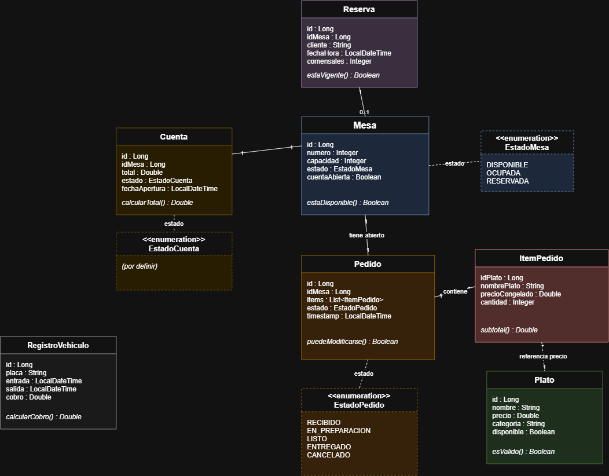

### Diagrama de componentes
Arquitectura interna: Controllers → Services → Validators/Mappers → Repositories → PostgreSQL, más la capa de seguridad (filtro JWT).

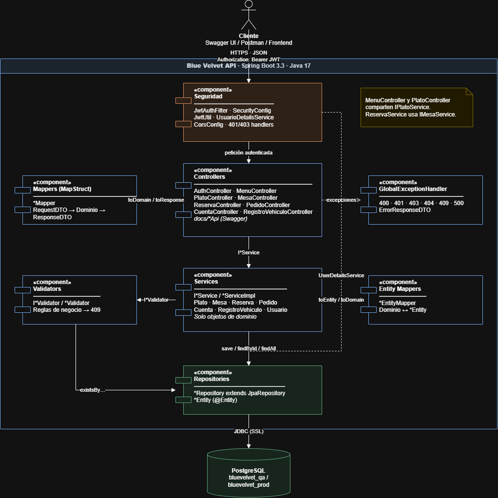

### Diagrama de secuencia — crear una reserva
Flujo principal: el cliente se autentica, el filtro JWT valida el token, el controller convierte el DTO, el service verifica que la mesa exista, el validator revisa que no haya cruce de horario y el repository guarda la reserva.

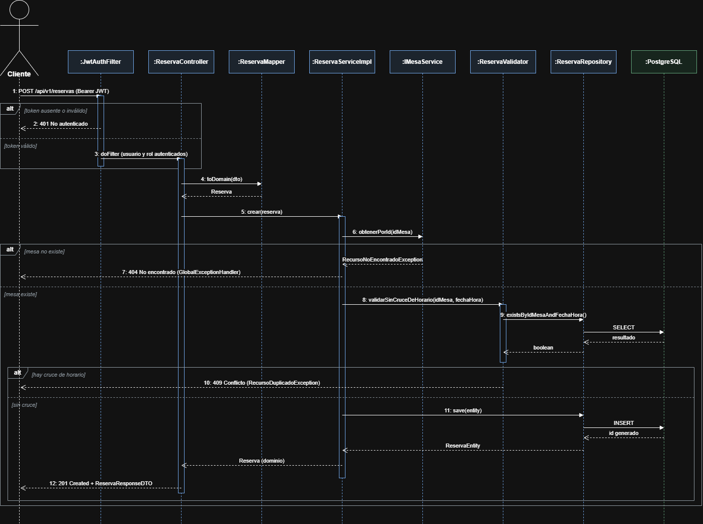

### Diagrama de despliegue
Desarrollador → GitHub → GitHub Actions → Docker Hub → Azure App Service (QA y PROD) → Azure Database for PostgreSQL.

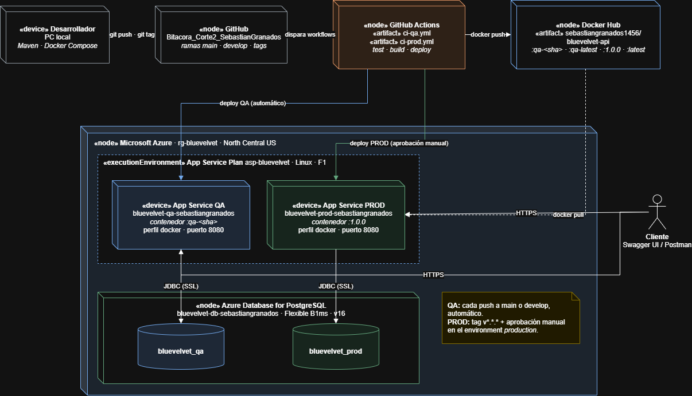

## 4. Arquitectura y estructura

Arquitectura en capas: **Controller → Service → Validator / Mapper → Repository → Base de datos**.

- El Controller solo recibe, convierte con el Mapper y delega. No tiene lógica de negocio.
- El Service trabaja solo con objetos de dominio y usa otros services siempre por su interfaz.
- Hay dos mappers por dominio: `*Mapper` (DTO ↔ Dominio) en el Controller y `*EntityMapper` (Dominio ↔ Entity) en el Service.
- `MenuController` y `PlatoController` reutilizan el mismo `IPlatoService`.

```
src/main/java/com/dosw/bluevelvet/
├── config/           SecurityConfig, CorsConfig, OpenApiConfig, DataInitializer
├── controller/       Un controller por dominio (+ Auth y Menu)
│   └── docs/         Interfaces *Api con la documentación Swagger
├── dto/              DTOs de entrada y salida + ErrorResponseDTO
├── entity/           Clases @Entity (persistencia)
├── exception/        Excepciones tipadas + GlobalExceptionHandler
├── mapper/           Mappers MapStruct (DTO ↔ Dominio y Dominio ↔ Entity)
├── model/domain/     Objetos de dominio con comportamiento propio
├── repository/       Interfaces JpaRepository
├── security/         JwtUtil, JwtAuthFilter, UserDetailsService, respuestas 401/403
├── service/          Interfaces I*Service + implementaciones
└── validator/        Reglas de negocio de cada dominio
```

## 5. Funcionalidades y endpoints

Todos los endpoints están bajo `/api/v1` y documentados en Swagger (`/swagger-ui/index.html`).

| Dominio | Endpoints | Regla de negocio |
|---|---|---|
| Autenticación | `POST /auth/login`, `POST /auth/registro` | Email único, password con BCrypt |
| Menú | `GET /menu` | Solo platos disponibles |
| Platos | `GET /platos`, `GET /platos/{id}`, `POST /platos`, `DELETE /platos/{id}` | Nombre único |
| Mesas | `GET /mesas`, `GET /mesas/{id}`, `POST /mesas`, `DELETE /mesas/{id}` | Número de mesa único |
| Reservas | `GET /reservas`, `GET /reservas/{id}`, `POST /reservas`, `DELETE /reservas/{id}` | La mesa existe y no hay cruce de horario |
| Pedidos | `GET /pedidos`, `GET /pedidos/{id}`, `GET /pedidos/mesa/{idMesa}`, `POST /pedidos` | Precio del plato congelado al pedir |
| Cuentas | `GET /cuentas`, `GET /cuentas/{id}`, `POST /cuentas` | Una cuenta abierta por mesa |
| Vehículos | `GET /vehiculos`, `GET /vehiculos/{id}`, `POST /vehiculos` | Placa sin registro activo duplicado |

Los errores usan el mismo formato (`ErrorResponseDTO`): **400** datos inválidos, **401** sin autenticar, **403** sin permiso, **404** no encontrado, **409** conflicto, **500** error interno (sin stack trace).

## 6. Persistencia

Persistencia relacional con **Spring Data JPA**. Se eligió una base relacional porque los datos del restaurante están muy relacionados (mesa → reservas → pedidos → cuenta) y necesitan integridad.

| Perfil | Base de datos | Uso |
|---|---|---|
| `h2` (por defecto) | H2 en memoria | Desarrollo local y pruebas, sin instalar nada |
| `postgres` | PostgreSQL local | Desarrollo con persistencia real |
| `docker` | PostgreSQL por variables de entorno | Docker Compose y Azure |

Cada dominio tiene su `*Entity` (sin lógica), su `*Repository` y su `*EntityMapper`. El ID lo genera la base de datos (`@GeneratedValue(strategy = IDENTITY)`).

## 7. Seguridad

Autenticación **stateless con JWT** (HS256, expira en 1 hora) y autorización por rol en `SecurityConfig`.

### Roles

| Rol | Quién es |
|---|---|
| `ADMIN` | Gerente del restaurante: administra todo |
| `CHEF` | Cocina: gestiona la carta y consulta pedidos |
| `MESERO` | Sala: mesas, reservas, pedidos, cuentas y parqueadero |
| `CLIENTE` | Comensal registrado: consulta platos y hace reservas |

### Permisos por endpoint

| Endpoint | Método | Público | ADMIN | CHEF | MESERO | CLIENTE |
|---|---|:-:|:-:|:-:|:-:|:-:|
| `/api/v1/auth/login`, `/auth/registro` | POST | ✔ | ✔ | ✔ | ✔ | ✔ |
| `/api/v1/menu` | GET | ✔ | ✔ | ✔ | ✔ | ✔ |
| `/api/v1/platos/**` | GET | | ✔ | ✔ | ✔ | ✔ |
| `/api/v1/platos` | POST | | ✔ | ✔ | | |
| `/api/v1/platos/{id}` | DELETE | | ✔ | | | |
| `/api/v1/mesas/**` | GET | | ✔ | | ✔ | |
| `/api/v1/mesas/**` | POST, DELETE | | ✔ | | | |
| `/api/v1/reservas` | POST | | ✔ | | ✔ | ✔ |
| `/api/v1/reservas/**` | GET, DELETE | | ✔ | | ✔ | |
| `/api/v1/pedidos/**` | GET | | ✔ | ✔ | ✔ | |
| `/api/v1/pedidos` | POST | | ✔ | | ✔ | |
| `/api/v1/cuentas/**` | GET, POST | | ✔ | | ✔ | |
| `/api/v1/vehiculos/**` | GET, POST | | ✔ | | ✔ | |

### Cómo probar en Swagger
1. `POST /api/v1/auth/login` con un usuario de prueba. Al arrancar se crea uno por rol (`admin@`, `chef@`, `mesero@`, `cliente@bluevelvet.com`) con la contraseña de la variable `SEED_PASSWORD`.
2. Copiar el `token` de la respuesta.
3. Clic en **Authorize**, pegar el token y ejecutar los endpoints protegidos.

### Medidas implementadas
- Passwords con **BCrypt** (nunca en texto plano ni en las respuestas).
- Secret JWT de 64 caracteres Base64 que llega por variable de entorno (`JWT_SECRET`), distinto en QA y PROD.
- Respuestas **401** (sin token, token inválido o expirado) y **403** (rol sin permiso) con el formato estándar de error.
- **CORS** solo para los orígenes del frontend (`CORS_ORIGINS`), sin `*` con credenciales.
- Headers: `X-Frame-Options: DENY`, `X-Content-Type-Options: nosniff`, `X-XSS-Protection` y `Content-Security-Policy`.
- CSRF deshabilitado porque la API es stateless con JWT.
- HTTPS en Azure (certificado administrado por App Service).

### Checklist OWASP Top 10

| # | Riesgo | ¿Aplica? | Mitigación |
|---|---|---|---|
| A1 | Control de acceso roto | Sí | Reglas por rol en `SecurityConfig`; pruebas de 403 en `SecurityIntegrationTest` |
| A2 | Fallas criptográficas | Sí | BCrypt, JWT HS256 con secret fuerte, HTTPS en Azure |
| A3 | Inyección | Sí | Solo métodos derivados de JPA, sin SQL concatenado |
| A4 | Diseño inseguro | Sí | Los ResponseDTO no exponen passwords; el registro público solo crea clientes |
| A5 | Mala configuración | Sí | Sin stack trace en errores, secretos en variables de entorno, consola H2 deshabilitada |
| A6 | Componentes vulnerables | Sí | Dependencias de Maven Central gestionadas por Spring Boot |
| A7 | Fallas de autenticación | Sí | Tokens con expiración, password de mínimo 8 caracteres con letras y números, token expirado → 401 |
| A8 | Integridad de datos | Sí | jjwt verifica la firma del token en cada petición |
| A9 | Logs y monitoreo | Sí | Se registran logins fallidos, tokens inválidos y accesos denegados |
| A10 | SSRF | No | La API no recibe URLs como parámetro |

### Evidencias de seguridad

| Evidencia | Captura |
|---|---|
| Login exitoso con JWT | 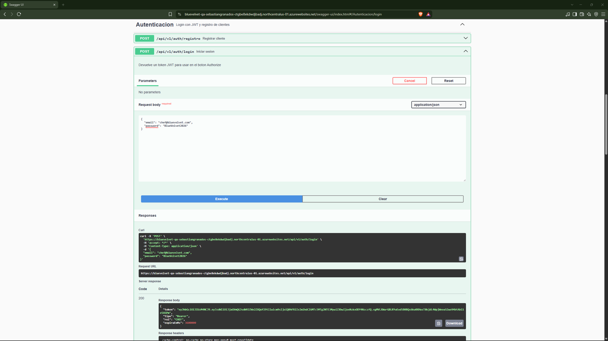 |
| 401 sin token | 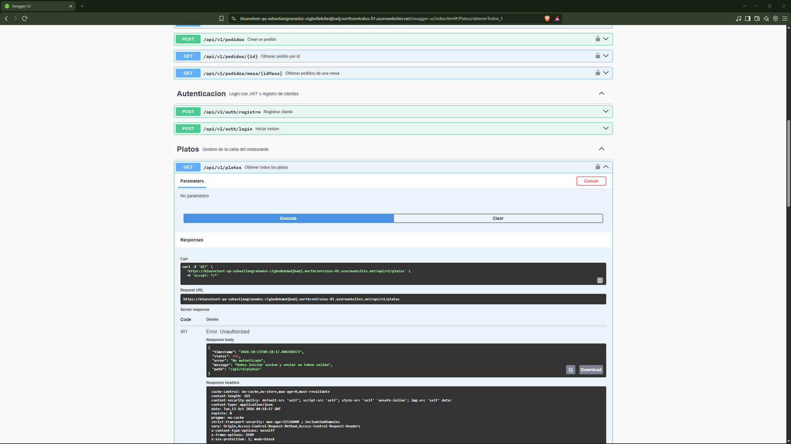 |
| 403 con rol incorrecto | 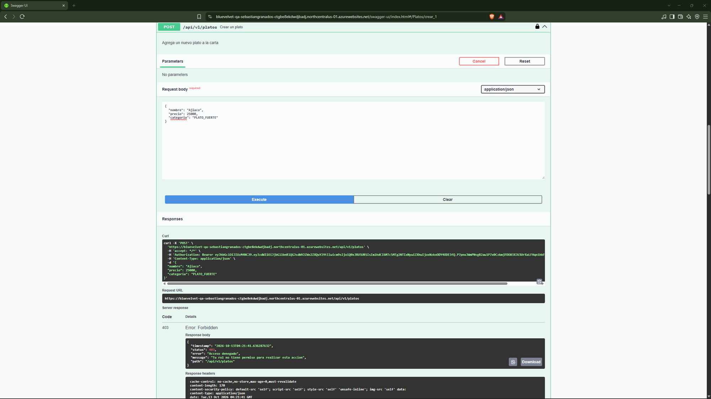 |
| Botón Authorize con el token | 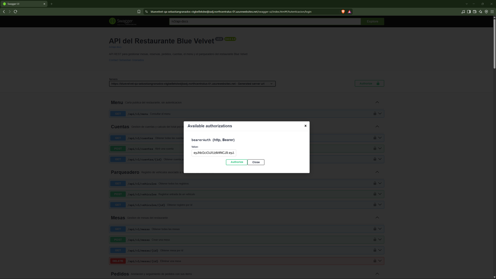 |
| Headers de seguridad en Postman |  |

## 8. Docker

La imagen es multietapa: compila con Maven y luego corre solo el JAR sobre `eclipse-temurin:17-jre-alpine`. `docker-compose.yml` levanta la API junto con PostgreSQL y un volumen para los datos.

```bash
cp .env.example .env      # llenar los valores
docker compose up --build -d
docker compose ps
```

Imagen publicada: [hub.docker.com/r/sebastiangranados1456/bluevelvet-api](https://hub.docker.com/r/sebastiangranados1456/bluevelvet-api)

| Variable | Descripción |
|---|---|
| `DB_PASSWORD` | Contraseña de PostgreSQL |
| `JWT_SECRET` | Secret Base64 para firmar los tokens (mínimo 44 caracteres) |
| `SEED_PASSWORD` | Contraseña de los usuarios de prueba (si se omite, no se crean) |
| `DB_HOST`, `DB_PORT`, `DB_NAME`, `DB_USER`, `DB_PARAMS` | Conexión a la base (en Compose ya vienen definidas) |
| `CORS_ORIGINS` | Orígenes del frontend permitidos (opcional) |

| Evidencia | Captura |
|---|---|
| `docker compose ps` con los servicios healthy | 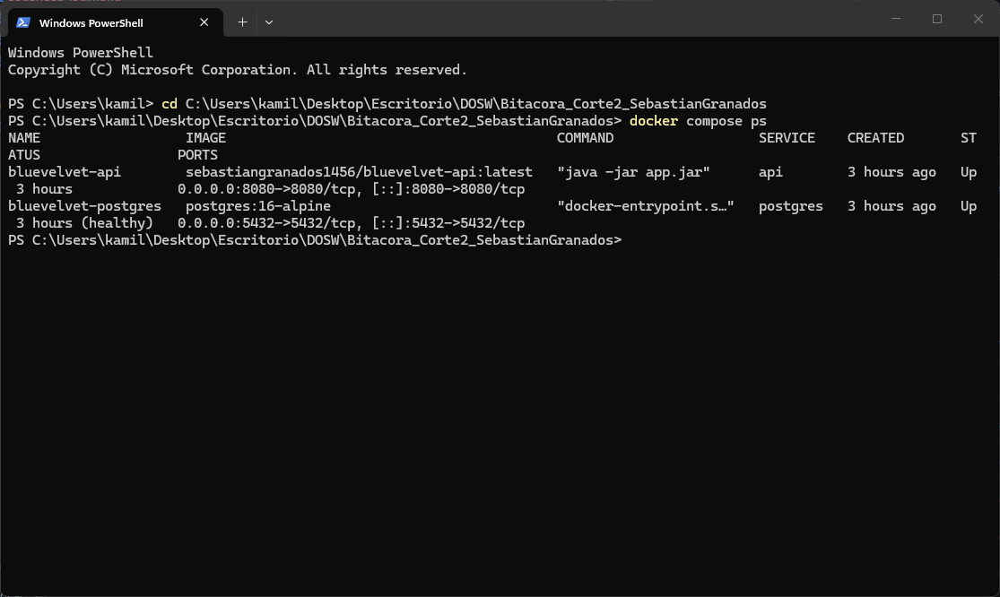 |
| Swagger corriendo en el contenedor | 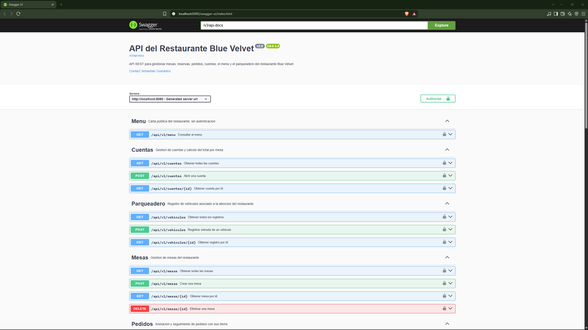 |
| Logs de inicio con conexión a la BD | 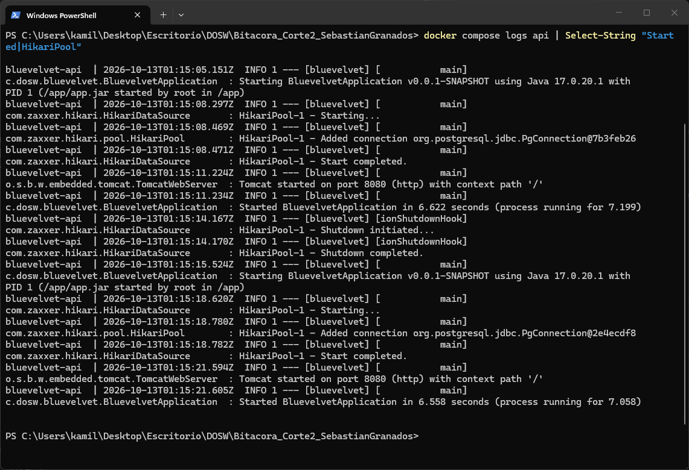 |
| Imagen en Docker Hub | 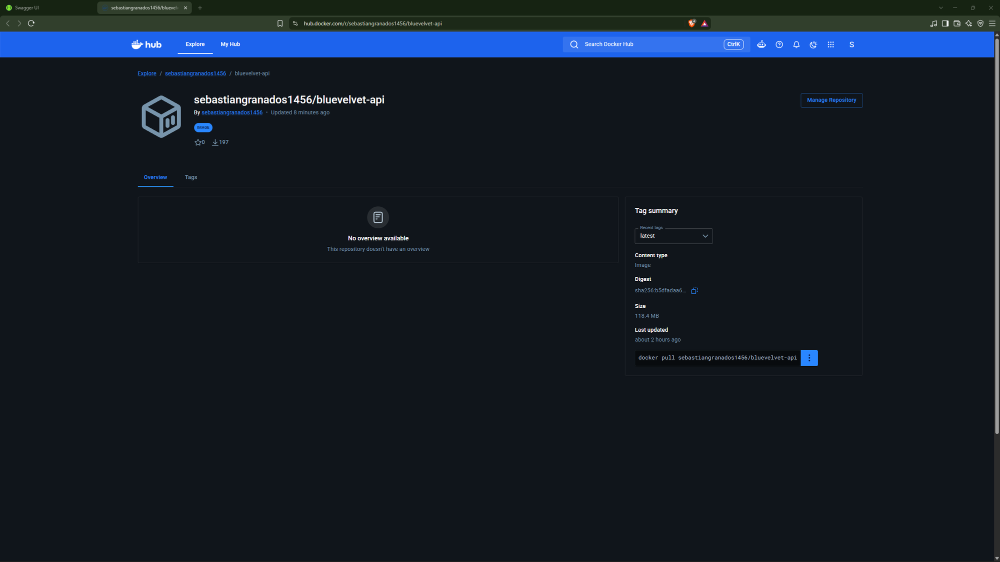 |

## 9. CI/CD y despliegue

### Ambientes

| Ambiente | Cuándo se despliega | Aprobación | URL |
|---|---|---|---|
| **QA** | Cada push a `main` o `develop` (`ci-qa.yml`) | Automática | `https://bluevelvet-qa-sebastiangranados-ctgbe8ekdwdjbadj.northcentralus-01.azurewebsites.net/swagger-ui/index.html` |
| **PROD** | Al crear un tag `v*.*.*` (`ci-prod.yml`) | Manual, en el environment `production` de GitHub | `https://bluevelvet-prod-sebastiangranados-ahhyhxcndzefgkgf.northcentralus-01.azurewebsites.net/swagger-ui/index.html` |

A QA llega todo lo que se integra, para probarlo. A PROD solo llega una versión etiquetada y aprobada.

### Pipelines
- **ci-qa.yml:** pruebas (`mvn verify` + reporte Jacoco) → imagen `qa-<sha>` en Docker Hub → variables y despliegue en el App Service de QA.
- **ci-prod.yml:** pruebas → imagen con la versión del tag y `latest` → pausa para aprobación → despliegue en el App Service de PROD.

Ambos App Services usan una base **Azure Database for PostgreSQL** con una base de datos por ambiente (`bluevelvet_qa` y `bluevelvet_prod`).

### Secrets de GitHub (solo nombres)
`DOCKERHUB_USERNAME`, `DOCKERHUB_TOKEN`, `AZURE_CREDENTIALS`, `AZURE_WEBAPP_NAME_QA`, `AZURE_WEBAPP_NAME_PROD`, `JWT_SECRET_QA`, `JWT_SECRET_PROD`, `DB_HOST`, `DB_USER`, `DB_PASSWORD`, `SEED_PASSWORD`.

| Evidencia | Captura |
|---|---|
| Pipeline de QA en verde | 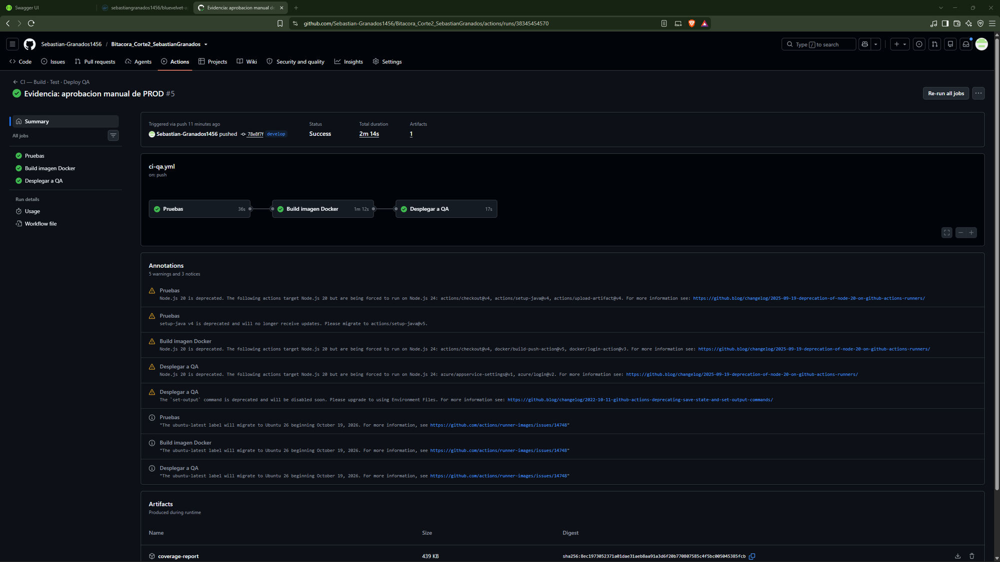 |
| Aprobación manual de PROD | 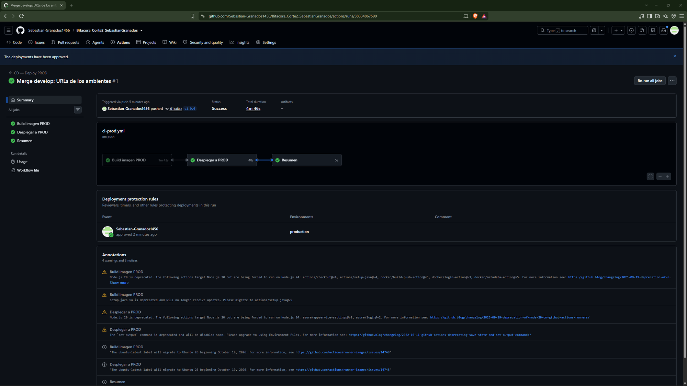 |
| Imagen en Docker Hub con los tags | 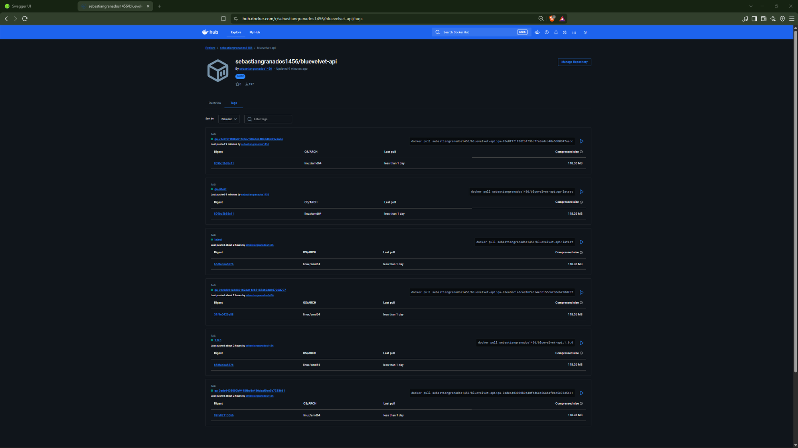 |
| App Service con el contenedor corriendo | 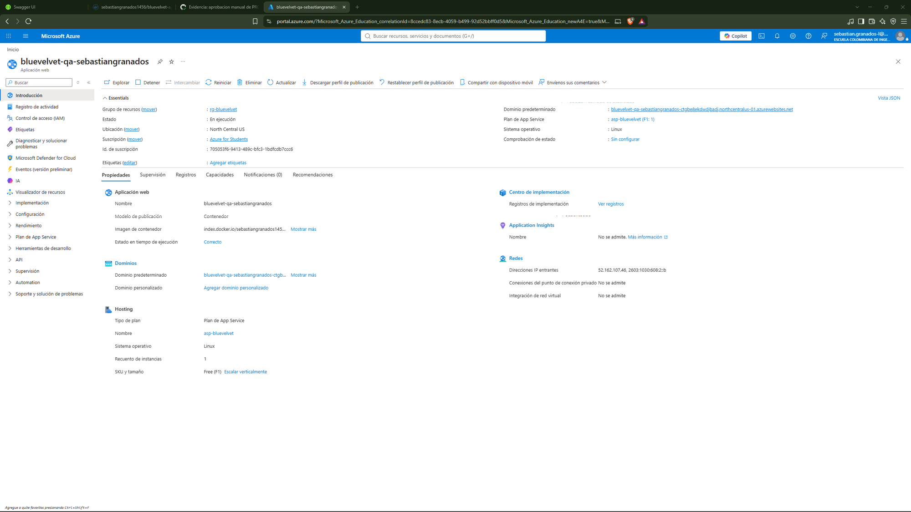 |

## 10. Cómo ejecutar

```bash
# Local con H2 (no requiere nada instalado)
mvn spring-boot:run

# Local con Docker y PostgreSQL
docker compose up --build -d
```

Swagger: `http://localhost:8080/swagger-ui/index.html`

## 11. Pruebas y calidad

```bash
mvn test
```

49 pruebas con JUnit 5 y Mockito:
- **Services y validators:** caso exitoso, no encontrado (404) y conflicto (409) por dominio.
- **Seguridad** (`SecurityIntegrationTest`, `JwtUtilTest`): login correcto e incorrecto, 401 sin token o con token inválido, 403 por rol, 201 con el rol correcto, menú público, registro sin exponer el password, headers de seguridad y tokens alterados o expirados.

| Evidencia | Captura |
|---|---|
| Swagger UI | 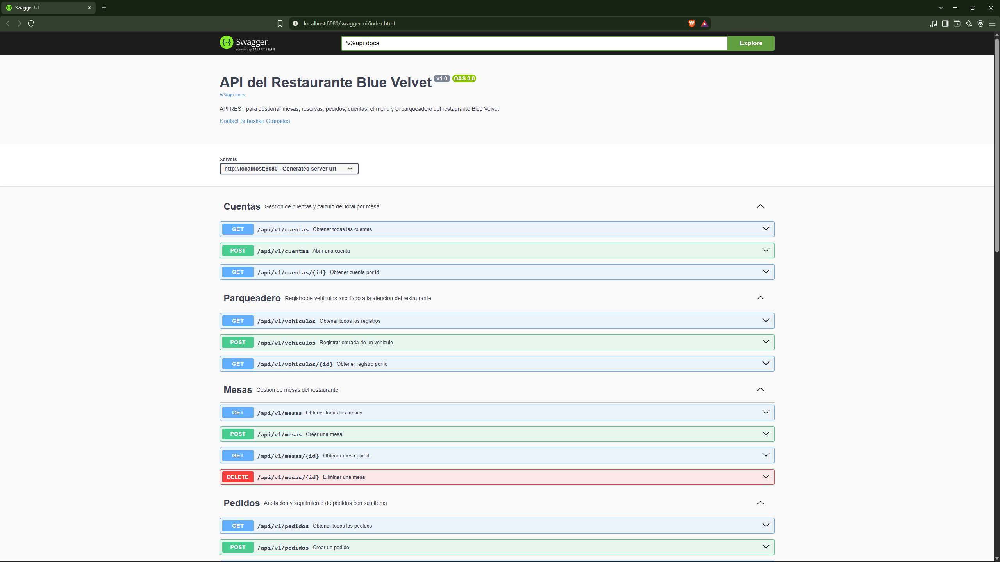 |
| Cobertura Jacoco | 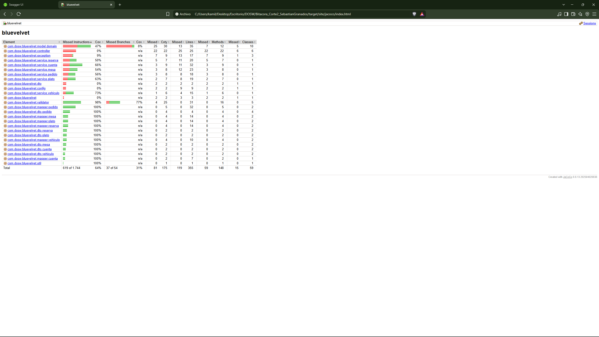 |
| Análisis SonarCloud | 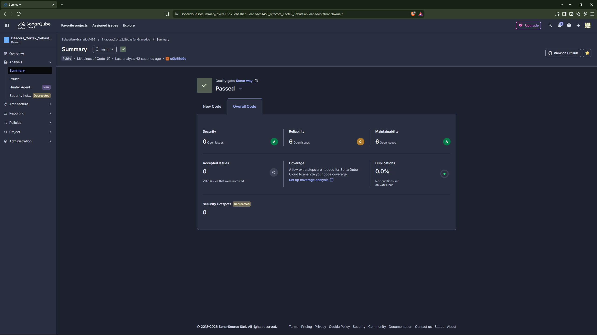 |
| Ejecución de `mvn test` | 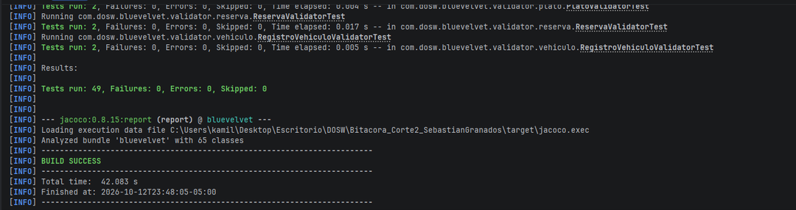 |
